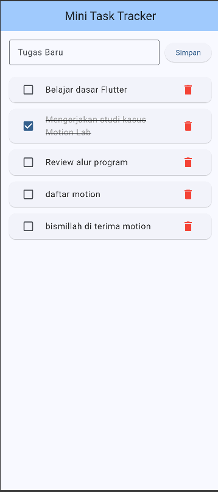

# Mini Task Tracker - Catatan Harian Sederhana

Aplikasi mobile sederhana 1 halaman berbasis Flutter untuk mencatat daftar tugas dan catatan harian secara lokal. Dibuat sebagai pemenuhan Lembar Penugasan Studi Kasus Peserta.

---

## Data Diri Peserta
- **Nama:** Gilang Ramadan
- **NIM:** 103012400304

---

## Fitur Aplikasi
1. **Input Data**: Tersedia kolom teks (TextField) untuk memasukkan judul tugas/catatan baru dan tombol **Simpan** (`ElevatedButton`).
2. **Tampilan Daftar (List)**: Daftar tugas yang telah ditambahkan langsung muncul secara dinamis di layar menggunakan `ListView.builder`.
3. **Aksi Sederhana**:
   - **Tandai Selesai (Centang)**: Menggunakan `Checkbox` untuk menandai tugas selesai (teks akan dicoret/strikethrough dan warna menjadi abu-abu).
   - **Hapus Catatan**: Tombol icon hapus (`Icons.delete`) berwarna merah untuk menghapus tugas dari daftar.
4. **State Management**: Menggunakan `setState` bawaan Flutter (disimpan langsung pada memori aplikasi/state lokal).

---

## Tangkapan Layar (Screenshot Demo)
<p align="center">
  
</p>

---

## Cara Menjalankan Aplikasi (How to Run)

### Prasyarat
- Flutter SDK (versi 3.x atau lebih baru)
- Perangkat Android (via USB Debugging), Emulator Android, atau browser Google Chrome

### Langkah-langkah
1. Clone repositori ini:
   ```bash
   git clone https://github.com/gilangggra/study-case-motionlab.git
   cd study-case-motionlab
   ```
2. Ambil seluruh dependensi package Flutter:
   ```bash
   flutter pub get
   ```
3. Jalankan aplikasi:
   - **Di browser (Web/Chrome):**
     ```bash
     flutter run -d chrome
     ```
   - **Di perangkat Android / Emulator:**
     ```bash
     flutter run
     ```
   - **Di desktop Windows:**
     ```bash
     flutter run -d windows
     ```

### Cara Build File .apk
Untuk menghasilkan file installer `.apk`:
```bash
flutter build apk --debug
```
*atau untuk release:*
```bash
flutter build apk --release
```
File APK akan berada pada folder: `build/app/outputs/flutter-apk/app-debug.apk` atau `app-release.apk`.

---

### Deklarasi Penggunaan AI
- Apakah menggunakan AI? Ya
- Tool AI yang digunakan: Gemini
- Estimasi persentase kontribusi AI: 20%
- Bagian kode/fitur yang dibantu AI: 
  Referensi struktur dasar ListView.builder, styling Checkbox ListTile, dan template dokumentasi README.
- Pernyataan: 
  "Saya menyatakan bahwa saya memahami alur dan fungsi dari seluruh kode yang ada dalam repositori ini"
